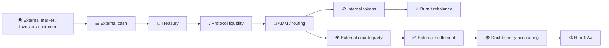

# 🏦 Print Money SYNERGYCHAIN — verified research dossier

> **Статус:** 🔬 R&D / documentation-only на текущем `main`.
> **Предмет:** программируемая ликвидность, эмиссия, mint/burn, bridge/AMM и отделение внутренней переоценки от внешнего экономического результата.
> **Проверено по фактическому дереву `main`:** 29.09.2026.

## 1. 🎯 Главный исследовательский вопрос

Можно ли использовать внутреннюю денежную топологию, AMM, mint/burn, protocol-owned liquidity и bridge-механизмы как средство оборота и перераспределения капитала так, чтобы **реальный экономический результат** оставался измеримым и не подменялся ростом внутренних номиналов?

Главная цель репозитория — формализовать границу:

[
	ext{Internal balance-sheet mechanics}

eq
	ext{External economic profit}
]

## 2. 📦 Фактическое состояние `main`

На момент аудита репозиторий содержит только:

```text
print_money_synergychain/
└── README.md
```

Runtime, simulator, contracts, tests, CI, datasets или evidence artifacts в текущем `main` отсутствуют.

Поэтому весь описанный ниже engine — **исследовательская спецификация**, а не существующая production-система.

## 3. 🧠 Базовая модель

Полезно разделять минимум пять слоёв:

1. **External assets** — реально принадлежащие внешние активы;
2. **Internal liabilities** — обязательства системы;
3. **Protocol-owned liquidity** — принадлежащая протоколу ликвидность;
4. **Internal marks** — цены собственных активов/LP;
5. **External realized cash flow** — результат сделок с внешним контрагентом.

Тогда условно:

[
HardNAV = ExternalAssets - ExternalLiabilities
]

а не:

[
HardNAV = InternalTokenPrice 	imes InternalSupply
]

если этот mark нельзя реализовать против внешнего спроса без разрушения цены.

## 4. 🛡️ Экономический firewall

```text
mint                    != profit
burn                    != profit
rebase                  != profit
own-token appreciation  != external wealth
own LP mark             != realized external P&L
flash-loan principal    != owned capital
new investor capital    != operating profit
bridge mirror           != second independent asset
internal transfer       != consolidated income
accounting entry        != cash inflow
```

Любое утверждение о прибыли должно в конечном счёте быть сведено к внешнему source/sink.

## 5. 🏗️ Целевая архитектура



Mint/burn может менять внутренний supply, но в HardNAV попадает только подтверждённое внешнее economic effect.

## 6. 📥 Планируемые inputs

- external cash inflow;
- pool reserves;
- token supply;
- LP ownership;
- oracle/external executable prices;
- bridge balances;
- liabilities;
- gas/fees/slippage;
- external order fills;
- repayment/settlement receipts;
- accounting policy version.

## 7. 📤 Планируемые outputs

- `DeltaHardNAV`;
- `DeltaExternalCash`;
- `DeltaLiabilities`;
- realized external P&L;
- internal mark change;
- protocol-owned LP value;
- flash debt;
- bridge exposure;
- solvency ratio;
- liquidity ratio;
- execution costs;
- reconciliation report.

## 8. 📊 Обязательные метрики

### HardNAV delta

[
Delta HardNAV =
HardNAV_{t+1} - HardNAV_t
]

### External cash conversion efficiency

[
CCR =
rac{Delta HardNAV_{consolidated}}
{ExternalUSDCInflow}
]

при условии, что numerator не содержит внутренний double count.

### Solvency

[
Solvency =
rac{ExternalAssets}
{ExternalLiabilities}
]

### Realized edge

[
RealizedEdge =
ExternalReceipts - ExternalCosts - Fees - Gas - Slippage
]

## 9. 🧪 Обязательная simulation discipline

Будущий simulator должен разделять:

```text
TRAIN
OOS
stress
adversarial
Monte-Carlo
historical replay
```

и сохранять для каждого run:

- seed;
- exact parameters;
- starting reserves;
- external price path;
- fee model;
- gas model;
- all mint/burn/add/remove LP events;
- all external fills;
- all liabilities;
- final reconciliation.

## 10. ⚠️ Failure modes

| Failure | Ложный вывод |
|---|---|
| own token repriced upward | «прибыль» без внешнего покупателя |
| LP mark counted as cash | ложная ликвидность |
| bridge mirror counted twice | завышенный NAV |
| flash principal added to assets without debt | искусственный капитал |
| investor deposit treated as P&L | fake operating profit |
| circular internal trades | объём без external value |
| unrealizable mark-to-market | phantom NAV |
| omitted gas/slippage | inflated strategy edge |

## 11. 🧪 Required tests будущей реализации

- conservation of external assets/liabilities;
- no double-count of bridge mirrors;
- flash loan net-zero principal after close;
- mint/burn alone cannot increase consolidated HardNAV;
- pure internal AMM cycle cannot create external wealth;
- LP add/remove roundtrip with zero external edge does not create profit;
- external investor deposit changes capital, not operating P&L;
- gas/slippage monotonic damage test;
- liquidity depletion stress;
- bank-run/redemption stress;
- oracle divergence;
- bridge outage;
- partial settlement failure.

## 12. 🛠️ Воспроизводимость текущего состояния

Сейчас воспроизводить simulator нечего: его нет в `main`.

Проверяемый current-state path:

```bash
git clone https://github.com/Shtenco/print_money_synergychain.git
cd print_money_synergychain
find . -maxdepth 2 -type f
```

Ожидаемый предметный результат: только `README.md`.

Это важная часть честного статуса: подробная теория **не считается реализацией**.

## 13. 🗺️ Карта репозитория

| Компонент | Статус |
|---|---|
| research specification | ✅ |
| economic invariants | ✅ |
| runtime simulator | ❌ |
| AMM engine | ❌ |
| bridge model | ❌ |
| double-entry ledger | ❌ |
| historical data | ❌ |
| unit/property tests | ❌ |
| observed evidence | ❌ |
| production deployment | ❌ |

## 14. 🔗 Место в SYNERGY

- [`synergy_graph_print_money`](https://github.com/Shtenco/synergy_graph_print_money) — graph/topology monetary R&D;
- [`synergy_qe`](https://github.com/Shtenco/synergy_qe) — issuance/QE experiments;
- [`synergy_2chain_qe`](https://github.com/Shtenco/synergy_2chain_qe) — two-chain/bridge monetary experiments;
- [`synergy_usds`](https://github.com/Shtenco/synergy_usds) — stable-value monetary surface;
- [`synergy_financial_os`](https://github.com/Shtenco/synergy_financial_os) — canonical accounting/NAV authority.

## 15. 🚀 Roadmap

1. создать deterministic double-entry simulator;
2. реализовать x·y=k pools и ownership accounting;
3. разделить internal marks и external executable prices;
4. добавить fee/gas/slippage;
5. добавить bridge accounting;
6. реализовать mint/burn invariants;
7. добавить external fills;
8. добавить Monte-Carlo/stress;
9. сформировать evidence bundles;
10. сверять каждый positive result через consolidated HardNAV;
11. только после этого разрешать performance claims.

## 16. 🛑 Что проект НЕ утверждает

- что «печать денег» создаёт бесплатное внешнее богатство;
- что mint/burn сам по себе прибыль;
- что внутренний TVL равен owned external NAV;
- что какая-либо стратегия уже протестирована кодом в этом repo;
- что существует production monetary protocol;
- что есть доказанная безынфляционная эмиссия;
- что есть гарантированный положительный HardNAV.

## 17. 📊 Текущий статус

```text
Theory / invariants        ✅
Repository audit           ✅
Executable model           ❌
Tests                      ❌
Historical replay          ❌
OOS                        ❌
Observed evidence          ❌
Production                 ❌
```

**Итог:** 🔬 R&D. README теперь является подробной исследовательской спецификацией, но не маскирует отсутствие runtime.

---

[🧭 SYNERGY SYSTEM](https://github.com/Shtenco/synergy_system) · [📚 Атлас 75 репозиториев](https://github.com/Shtenco/synergy_system/blob/main/docs/SYNERGY_REPOSITORY_ATLAS.md) · [🧾 Registry](https://github.com/Shtenco/synergy_system/blob/main/registry/SYNERGY_REPOSITORIES.json)
