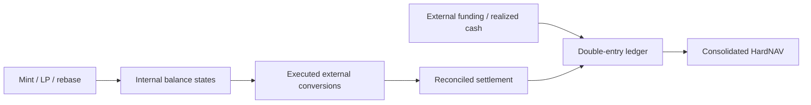

# SYNERGY Money Research — programmable circulation with real-asset constraints

## The original research question

Can internal AMM, issuance, burn and liquidity-routing operations improve the **use of externally available capital** without mistaking internally quoted asset prices for economic wealth? The project asks this question as a formal financial design, not as a claim that token minting creates spendable dollars.

Current main is **specification-only**. Its value lies in posing measurable invariants that future simulators and contracts can validate and in assigning authority to external settlement and accounting.

## Accounting model

Let A represent eligible external assets, L enforceable external liabilities, and M a valuation of internally minted claims. A conservative consolidated measure is

$$
HardNAV=A-L.
$$

The quantity M is excluded when it merely reflects the protocol's own quoted price without a realizable independent market. Internal supply, pool and mark changes remain observable but distinct.

For a period with externally settled receipts R and all genuinely external expenses K, changes in eligible economic value require a reconciliation, rather than assuming

$$
\Delta HardNAV = \Delta \mathrm{MarketCap}_{\mathrm{self-token}}.
$$

That equality is **not generally valid**; this is precisely the hypothesis the project must refuse to assume.

## Proposed conservation ledger

A testable simulation should emit entries for external stablecoins, controlled token balances, pool reserves, claims on external counterparties, bridge obligations, flash debt and execution fees. Each transaction supplies both token-unit conservation and valuation in the actual settlement asset.

## Scientific experiments

Create deterministic CPMM fixtures with and without externally productive capital. Test mint/sell, buyback/burn, LP deposit/withdrawal, flash loan cycles, bridge mirroring and order-book execution costs. Assertions include reserve conservation, no double-counted flash principal, distinct profit vs new investor capital, and zero falsely claimed external profit from pure self-valuation.

Compare economic outcomes across randomized exogenous demand and price regimes with a sealed out-of-sample schedule. Measure HardNAV, reserve adequacy, liquidity drawdown and the fraction of cycles with positive **realized net external return**.

## Research and commercial relevance

The project could become a monetary experimentation framework for protocol treasuries and tokenized settlement design. Its novelty is the effort to combine programmable circulation mechanisms with an explicit **external-value firewall**, while leaving trading predictions, payment execution and canonical accounting to their separate owners.

[Original specification](../README.md) · [Financial OS](https://github.com/Shtenco/synergy_financial_os)
